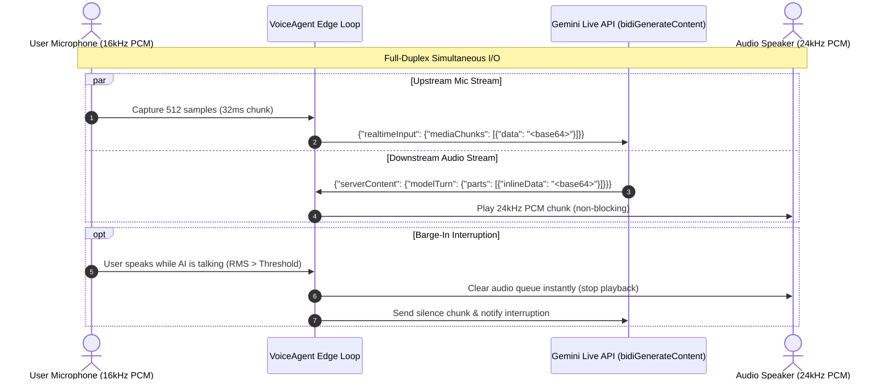
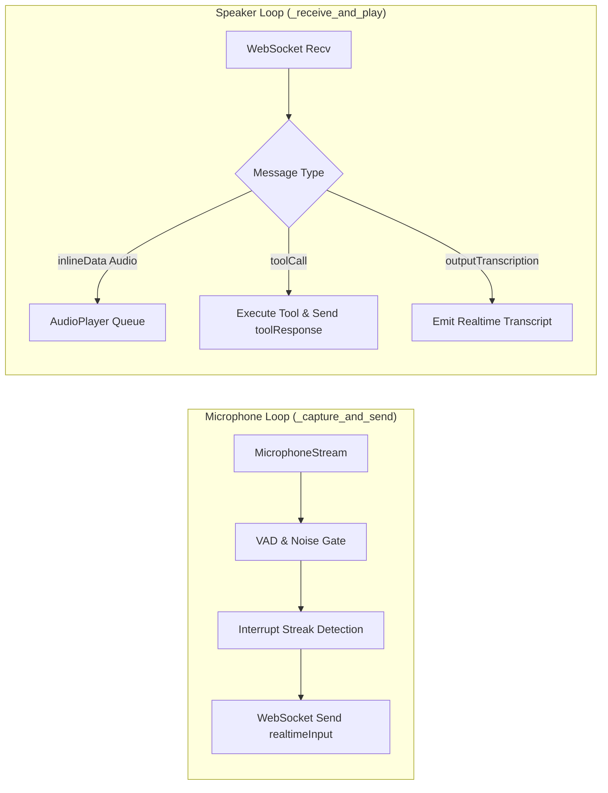

# Full-Duplex Streaming Architecture

Full-duplex voice communication means that both parties—the user and the AI agent—can speak and listen simultaneously. Unlike traditional half-duplex voice assistants that require rigid "push-to-talk" or wait for a turn to end before responding, the **Voice AI Framework** streams audio continuously over a single bidirectional WebSocket connection.



---

## 1. Bidirectional WebSocket Connection

The framework communicates with Google's Gemini Multimodal Live API using the WebSocket endpoint:

```text
wss://generativelanguage.googleapis.com/ws/google.ai.generativelanguage.v1beta.GenerativeService.BidiGenerateContent?key={API_KEY}
```

### Connection Handshake
Upon establishing the WebSocket connection, the agent sends an initial configuration payload specifying:
1. **Model ID**: `models/gemini-3.1-flash-live-preview` (or configured model).
2. **Generation Configuration**: Output audio modality, PCM encoding at 24kHz, and desired voice persona (e.g. `Puck`, `Aoede`, `Charon`).
3. **System Instructions**: The composed dynamic prompt containing persona rules, memory state, and tool schemas.
4. **Function Declarations**: OpenAPI-compatible schemas for all registered tools.

```python
setup_payload = {
    "setup": {
        "model": "models/gemini-3.1-flash-live-preview",
        "generationConfig": {
            "responseModalities": ["AUDIO"],
            "speechConfig": {
                "voiceConfig": {
                    "prebuiltVoiceConfig": {
                        "voiceName": "Puck"
                    }
                }
            }
        },
        "systemInstruction": {
            "parts": [{"text": effective_prompt}]
        },
        "tools": tool_declarations
    }
}
```

---

## 2. Audio Framing & Specifications

Audio data is streamed in raw Linear PCM format without compression overhead, minimizing processing and encoding latencies:

| Parameter | Input Stream (Microphone) | Output Stream (Speaker) |
| :--- | :--- | :--- |
| **Sample Rate** | 16,000 Hz (16 kHz) | 24,000 Hz (24 kHz) |
| **Channels** | 1 (Mono) | 1 (Mono) |
| **Bit Depth** | 16-bit signed integer (`int16`, little-endian) | 16-bit signed integer (`int16`, little-endian) |
| **Chunk Size** | 512 samples (1,024 bytes) | Variable streaming packets |
| **Chunk Duration**| **32.0 milliseconds** | Continuous stream |

---

## 3. Concurrent Worker Coroutines

Inside `VoiceAgent.run_edge`, audio I/O and protocol management are split into two parallel asynchronous tasks:



### Upstream: `_capture_and_send`
- Reads 512-sample PCM chunks non-blockingly from `MicrophoneStream`.
- Calculates Root Mean Square (RMS) energy to detect speech vs. background noise.
- Checks if the user is interrupting active AI playback (barge-in).
- Encodes speech chunks to Base64 and sends them over the WebSocket connection.

### Downstream: `_receive_and_play`
- Listens for incoming server frames from Gemini.
- Decodes Base64 audio PCM and feeds it into the low-latency `AudioPlayer` thread queue.
- Extracts real-time spoken transcripts (`serverContent.outputTranscription.text`) for event listeners and UI display.
- Intercepts `toolCall` invocations, executes the requested function asynchronously, and returns the `toolResponse` in the same duplex session.

---

## 4. Latency Optimization Techniques

To achieve sub-second conversational latency:
1. **Native 16kHz Negotiation**: Captures directly at 16kHz hardware rate if supported by the sound card, bypassing CPU-heavy resampling filters (`audioop.ratecv`).
2. **Compact 512-Frame Buffers**: Cuts frame buffering delay to 32ms compared to traditional 1024 or 2048 buffers.
3. **Calibrated Trailing Hang Frames**: Emits ~480ms of trailing room ambient sound after user speech ends. This allows Gemini's server-side neural VAD to immediately identify sentence completion and begin token generation without timeout delays.
4. **WebSocket Ping Interval**: Set to `ping_interval=None` to avoid interfering with Gemini Live's proprietary streaming protocol.

