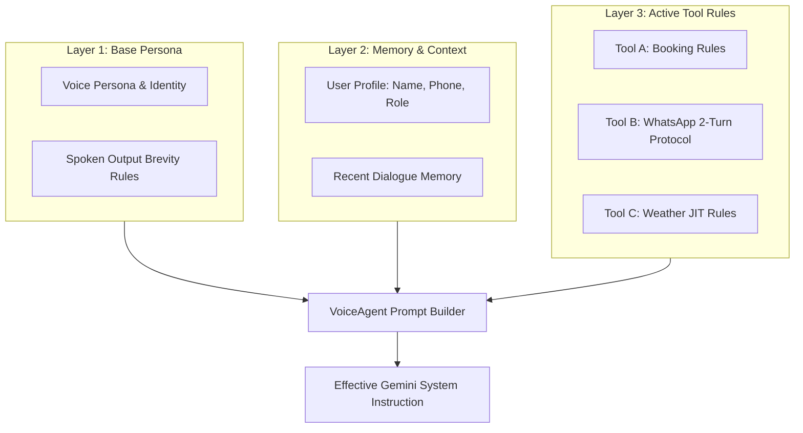

# Dynamic Prompt Composition

In high-performance voice AI systems, a static system prompt often fails:
- It bloats the context window with instructions for tools that aren't enabled.
- It cannot easily inject dynamic caller identity or user profile data.
- It struggles to enforce strict conversational guardrails (such as 2-turn verbal verification protocols).

The **EdgeVoiceAI Framework** solves this with **Three-Layer Dynamic Prompt Composition**, managed automatically by `VoiceAgent.build_effective_system_instruction`.



---

## 1. The Three Layers of Voice Prompts

### Layer 1: Base Persona & Spoken Conversational Rules
Defines who the agent is and how it speaks. Spoken language must be radically more concise than written chatbots:

```text
You are a warm, helpful, and concise voice AI assistant.
Speak in natural, conversational sentences suitable for speech synthesis.
Keep spoken responses to 1-2 brief sentences unless explaining detailed steps.
Never output markdown tables, asterisks, or bullet lists; speak naturally.
```

### Layer 2: Memory & Caller Context
Dynamically injects caller information retrieved from session storage or SQLite databases:

```text
[CURRENT CALLER CONTEXT]
• User ID: user_492
• Name: Ramesh Patel
• Preferred Language: English / Gujarati
• Location: Anand, Gujarat
```

### Layer 3: Active Tool Rules & Guardrails
Each tool subclassing `BaseTool` can override `prompt_instruction` to inject instructions that govern how and when the tool may be invoked:

```python
class SendWhatsAppMessageTool(BaseTool):
    # ...
    @property
    def prompt_instruction(self) -> str | None:
        return (
            "• NOTIFICATION & MESSAGING PROTOCOL (`send_whatsapp_message`):\n"
            "  1. When the user asks to send an answer or provides their phone number, "
            "DO NOT call `send_whatsapp_message` in that turn.\n"
            "  2. First say verbally: 'Your phone number is [phone_number], correct?' and stop speaking.\n"
            "  3. Only in the subsequent turn, after the user confirms (e.g. 'yes/correct'), call `send_whatsapp_message`.\n"
            "  4. Never invent or use dummy phone numbers like '0000000000'."
        )
```

---

## 2. Dynamic Assembly in `VoiceAgent`

The agent combines these layers into a unified prompt string whenever the voice agent initializes or reconnects:

```python
# Inside VoiceAgent:
sys_instruction = await agent.build_effective_system_instruction(session_id="default")
```

Under the hood:
1. Starts with `config.system_instruction`.
2. Asynchronously fetches caller profile data from `memory.build_context_prompt(session_id)`.
3. Calls `tools.build_tools_instruction()`, which loops through all registered `BaseTool` instances, collecting every non-empty `tool.prompt_instruction`.

### Rendered Output Example

```text
You are a helpful, concise voice AI assistant.

[CALLER CONTEXT]
• name: Ramesh Patel
• phone: +919876543210

[ACTIVE TOOLS & USAGE RULES]
• APPOINTMENT BOOKING RULE:
  1. Verbally ask the user for preferred day and service before booking.
  2. Confirm the appointment in 1 spoken sentence.

• NOTIFICATION & MESSAGING PROTOCOL (`send_whatsapp_message`):
  1. When the user asks to send an answer or provides their phone number, DO NOT call `send_whatsapp_message` in that turn.
  2. First say verbally: 'Your phone number is [phone_number], correct?' and stop speaking.
  3. Only in the subsequent turn, after the user confirms (e.g. 'yes/correct'), call `send_whatsapp_message`.
  4. Never invent or use dummy phone numbers like '0000000000'.
```

---

## 3. Benefits of Dynamic Composition

1. **Zero Hallucination of Parameters**: By explicitly instructing the model to verbally confirm missing or sensitive parameters, tools are never called with invented arguments (such as fake phone numbers or default appointment times).
2. **Context Efficiency**: If a tool is removed from the registry, its prompt template is omitted automatically, saving prompt tokens and keeping the model focused.
3. **Multi-Agent & Multi-Tenant Support**: Agents serving different caller roles (e.g. customer vs. administrator) dynamically receive different tool subsets and tailored instructions.
