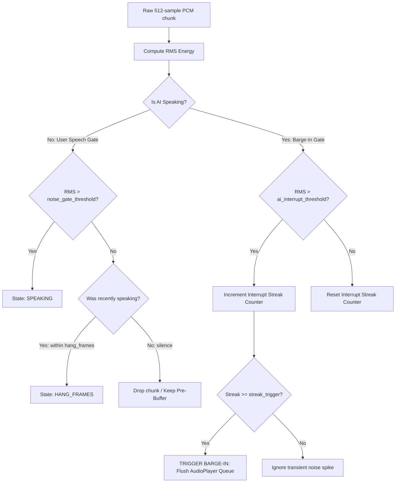

# Voice Activity Detection (VAD) & Barge-In

Natural human conversation requires seamless interruptions (barge-in) and accurate speech boundary detection. The framework implements an edge-optimized Voice Activity Detection (VAD) pipeline combined with immediate playback queue interruption.

---

## 1. How VAD Works on the Edge

Speech detection happens in real-time inside `MicrophoneStream` and `VoiceAgent._capture_and_send` using Root Mean Square (RMS) energy calculation on 16-bit PCM audio.



### RMS Energy Calculation

The RMS value represents the sound volume of an audio frame:

$$\text{RMS} = \sqrt{\frac{1}{N} \sum_{i=1}^{N} x_i^2}$$

In Python (`audioop` or native `struct` unpack):

```python
import audioop

rms = audioop.rms(raw_pcm_chunk, 2)  # 2 bytes per sample for 16-bit PCM
```

---

## 2. Speech Boundary Detection

To avoid cutting off the beginning of words (consonant onsets) or chopping off the ends of sentences, the framework uses a two-stage sliding window:

### 1. Pre-buffering (`pre_buffer_max_frames=8`)
Human speech typically begins with soft consonants (e.g. "p", "t", "s") whose amplitude is lower than the active speech threshold.
- The stream maintains a circular buffer of the last 8 frames (~256 ms).
- When the RMS threshold is exceeded, the pre-buffered frames are immediately flushed to the upstream stream.
- This ensures zero loss of initial syllables.

### 2. Hang Frames (`hang_frames=15`)
Natural speech contains brief pauses between words or clauses:
- When RMS drops below `noise_gate_threshold`, the stream does not cut off immediately.
- It continues sending for 15 frames (~480 ms) of ambient room noise.
- This prevents speech fragmentation and gives Gemini's neural VAD the natural acoustic cue needed to recognize turn completion.

---

## 3. Barge-In Interruption Detection

When the AI is speaking, sound waves travel from the laptop/device speakers into the surrounding room and can bleed into the microphone.

To prevent the AI from interrupting itself due to speaker bleed while still allowing the human user to interrupt:

### The Dual-Threshold Strategy

| State | Active Threshold | Default RMS | Purpose |
| :--- | :--- | :--- | :--- |
| **AI is Silent** | `noise_gate_threshold` | `250` | Detects soft human speech onset while ignoring room hum. |
| **AI is Speaking** | `ai_interrupt_threshold` | `2800` | Requires loud intentional speech above speaker echo bleed. |

### Streak Detection (`streak_trigger=4`)
A momentary click, cough, or acoustic echo spike lasts for 1–2 frames (30–60 ms). To avoid false barge-ins:
- The system requires **4 consecutive frames** (~128 ms) exceeding `ai_interrupt_threshold` before triggering an interruption.
- Once triggered:
  1. `audio_player.clear()` immediately purges buffered audio chunks from the speaker queue.
  2. The speaker becomes instantly silent.
  3. The `on_interrupted` callback is dispatched.
  4. The user's new utterance is streamed directly to Gemini to take over the conversation turn.

---

## 4. Hardware Calibration Guide

Different audio environments require different sensitivity profiles:

```python
from edgevoiceai import AudioConfig

# Setup for quiet office with USB Headset
headset_config = AudioConfig(
    noise_gate_threshold=150,     # Very sensitive mic close to mouth
    ai_interrupt_threshold=1200,   # Low echo bleed through headphones
    hang_frames=12,
    streak_trigger=3
)

# Setup for laptop built-in mic & built-in speakers (High speaker bleed)
laptop_config = AudioConfig(
    noise_gate_threshold=300,
    ai_interrupt_threshold=2800,   # High threshold to resist loud speaker echo
    hang_frames=15,
    streak_trigger=4
)

# Setup for noisy kiosk or agricultural field unit
field_config = AudioConfig(
    noise_gate_threshold=600,     # Filter out wind / tractor rumble
    ai_interrupt_threshold=3500,
    hang_frames=18,
    streak_trigger=5
)
```

