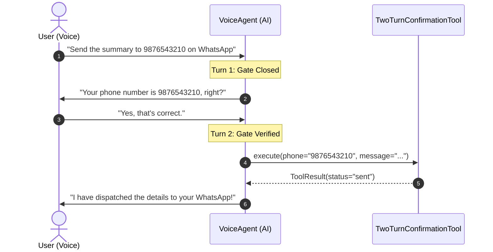

# Custom Tools & Prompt Templates

Tools are what give a Voice AI assistant real-world agency—querying databases, scheduling calendar visits, triggering notifications, or checking telemetry sensors.

In voice applications, **tool execution is fundamentally different from text chatbots**:
- **Verbal Etiquette**: The AI must not recite raw JSON, database IDs, or technical error messages aloud.
- **Natural Confirmation**: Destructive or outbound actions (like sending messages or booking slots) require verbal confirmation before execution.
- **Conversational Brevity**: Responses must be synthesized into 1–2 spoken sentences.

`edgevoiceai` introduces **Self-Describing Tools with Prompt Templates** to solve these challenges modularly.

---

## 1. The `BaseTool` Specification

Every tool in `edgevoiceai` subclasses `BaseTool`:

```python
from typing import Any, Dict, Optional
from edgevoiceai import BaseTool, ToolExecutionContext, ToolResult

class MyCustomTool(BaseTool):
    @property
    def name(self) -> str:
        """Unique identifier used by Gemini Live for function calling."""
        return "my_tool"

    @property
    def description(self) -> str:
        """Detailed description informing Gemini when and why to call this tool."""
        return "Fetches real-time status updates for a user account."

    @property
    def parameters_schema(self) -> Dict[str, Any]:
        """JSON Schema defining the expected arguments."""
        return {
            "type": "OBJECT",
            "properties": {
                "account_id": {"type": "STRING", "description": "The customer account ID."}
            },
            "required": ["account_id"],
        }

    @property
    def prompt_instruction(self) -> Optional[str]:
        """Usage rules and verbal guidelines injected into the effective system prompt."""
        return (
            "• ACCOUNT STATUS RULE (`my_tool`):\n"
            "  1. Only invoke this tool when the user asks for account status.\n"
            "  2. Report the balance in 1 spoken sentence without reading internal ledger codes."
        )

    async def execute(self, args: Dict[str, Any], context: ToolExecutionContext) -> ToolResult:
        """Asynchronous execution logic."""
        account_id = args.get("account_id", "")
        # ... fetch data ...
        return ToolResult(
            status="success",
            message="Account is active with a balance of $120.",
            data={"balance": 120.0, "status": "active"},
        )
```

---

## 2. Per-Tool Prompt Templates & Dynamic Composition

### The Problem with Monolithic Prompts
In traditional voice agents, developers write massive, 200-line system prompts containing usage rules for every single tool. When you add, remove, or modify a tool, you have to carefully edit the monolithic prompt, leading to prompt drift and hallucinations.

### The Solution: Self-Describing Tools
In `edgevoiceai`, every tool defines its own `@property prompt_instruction`.

When tools are registered in the `ToolRegistry`:
```python
tools = ToolRegistry()
tools.register(AppointmentTool())
tools.register(WhatsAppNotificationTool(config=whatsapp_config))
tools.register(KnowledgeBaseTool(...))
```

The framework automatically compiles all active instructions into a clean prompt section:

```text
[ACTIVE TOOLS & USAGE RULES]
• APPOINTMENT BOOKING PROTOCOL (`book_appointment`):
  1. Only invoke this tool when the user explicitly requests to book a visit.
  2. Verbally ask for their preferred day and service type before booking.
  3. Confirm the appointment in 1 concise spoken sentence.

• NOTIFICATION & MESSAGING PROTOCOL (`send_whatsapp_message`):
  1. When the user asks to send an answer or provides their phone number, DO NOT call `send_whatsapp_message` in that turn.
  2. First say verbally: 'Your phone number is [phone_number], correct?' and stop speaking.
  3. Only in the subsequent turn, after the user confirms (e.g. 'yes/correct'), call `send_whatsapp_message`.
  4. Never invent or use dummy phone numbers like '0000000000'.
```

When `VoiceAgent.build_effective_system_instruction()` runs, it combines:
1. **Base Persona Prompt** (identity & voice tone)
2. **User Memory / Profile Context** (known user facts)
3. **Active Tool Rules** (aggregated dynamically via `tools.build_tools_instruction()`)

---

## 3. The Strict 2-Turn Confirmation Pattern

Outbound notifications (SMS, WhatsApp, emails) or financial actions should never be triggered on the first turn. If a user says *"Send that to my WhatsApp at 9876543210"*, the model might mishear a digit or dispatch prematurely.

`edgevoiceai` includes a built-in `TwoTurnConfirmationNotificationTool` that enforces a verbal confirmation gate:



To create your own 2-turn confirmation tool, inherit from `TwoTurnConfirmationNotificationTool`:

```python
from edgevoiceai import TwoTurnConfirmationNotificationTool, ToolExecutionContext, ToolResult

class SecureOrderCancellationTool(TwoTurnConfirmationNotificationTool):
    @property
    def name(self) -> str:
        return "cancel_customer_order"

    @property
    def description(self) -> str:
        return "Cancels a customer order after explicit verbal 2-turn confirmation."

    async def _send_notification(self, target: str, content: str) -> None:
        # target is the verified Order ID
        await order_db.cancel_order(order_id=target, reason=content)
```

---

## 4. Understanding `ToolResult`

The return value of `execute()` is a `ToolResult` dataclass:

```python
@dataclass
class ToolResult:
    status: str                         # "success", "error", "pending_confirmation", etc.
    message: Optional[str] = None       # Concise text feedback for Gemini's next turn
    data: Optional[Dict[str, Any]] = None  # Structured data payload
    jit_instruction: Optional[str] = None # Just-In-Time instruction for the model
    client_event: Optional[Dict[str, Any]] = None # Optional event pushed to UI clients
    queued_audio_url: Optional[str] = None # Audio file to play immediately after AI speech
```

### Just-In-Time (JIT) Instructions
A JIT instruction gives dynamic, context-specific guidance to Gemini for that specific turn only:

```python
return ToolResult(
    status="success",
    message="Sensor temperature is 42 degrees Celsius.",
    jit_instruction=(
        "Warn the user immediately that the machine temperature is critical. "
        "Recommend shutting down the motor in 1 spoken sentence."
    )
)
```

Gemini receives this instruction in the `functionResponse` payload and immediately acts on it without cluttering the global system prompt.

---

## 5. Complete Example: Weather & Environmental Sensor Tool

Here is a complete, copy-pasteable example of a custom hardware telemetry tool:

```python
import asyncio
from typing import Any, Dict
from edgevoiceai import BaseTool, ToolExecutionContext, ToolResult, ToolRegistry

class WarehouseSensorTool(BaseTool):
    """Monitors live warehouse humidity and temperature sensors."""

    @property
    def name(self) -> str:
        return "read_warehouse_sensors"

    @property
    def description(self) -> str:
        return "Reads current temperature and humidity telemetry from warehouse sensors."

    @property
    def parameters_schema(self) -> Dict[str, Any]:
        return {
            "type": "OBJECT",
            "properties": {
                "zone": {
                    "type": "STRING",
                    "description": "Warehouse zone name (e.g. 'cold_storage', 'loading_dock').",
                }
            },
            "required": ["zone"],
        }

    @property
    def prompt_instruction(self) -> str:
        return (
            "• WAREHOUSE SENSOR RULE (`read_warehouse_sensors`):\n"
            "  1. When the user asks about temperature or warehouse conditions, call this tool.\n"
            "  2. Report both temperature and humidity in a conversational tone.\n"
            "  3. Do not invent readings without calling the tool."
        )

    async def execute(self, args: Dict[str, Any], context: ToolExecutionContext) -> ToolResult:
        zone = args.get("zone", "cold_storage")

        # Simulate hardware sensor read
        temp_c = 4.2 if zone == "cold_storage" else 22.5
        humidity = 85.0 if zone == "cold_storage" else 45.0

        return ToolResult(
            status="success",
            message=f"Zone '{zone}' reading: {temp_c}°C, {humidity}% humidity.",
            data={"zone": zone, "temp_c": temp_c, "humidity": humidity},
            jit_instruction=(
                f"State the {zone} conditions clearly in 1 spoken sentence. "
                "Confirm that temperature is within optimal range."
            ),
        )


# Registering into the Registry:
tools = ToolRegistry()
tools.register(WarehouseSensorTool())
```

