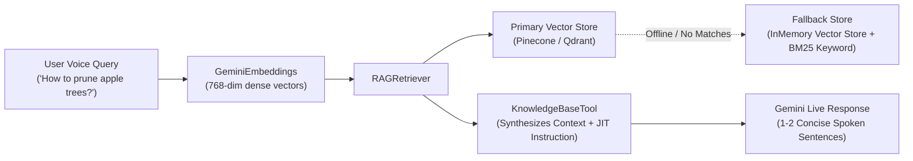

# RAG & Vector Database Stores

Retrieval-Augmented Generation (RAG) allows your Voice AI assistant to query authoritative knowledge bases, documentation, policies, and farmer experiences without hallucinating facts.

`edgevoiceai` provides a unified RAG abstraction with plug-and-play vector databases and built-in offline fallbacks.

---

## 1. Core Architecture



---

## 2. Choosing a Vector Store

`edgevoiceai` provides 3 standard vector store implementations:

| Vector Store | Class | Persistence | Ideal For |
|---|---|---|---|
| **In-Memory** | `InMemoryVectorStore` | Memory (ephemeral) / Local Dict | Zero-dependency testing, offline edge devices, small knowledge bases (<10k chunks). |
| **Qdrant** | `QdrantVectorStore` | On-premise Docker / Qdrant Cloud | Private server hosting, high-throughput self-hosted deployments. |
| **Pinecone** | `PineconeVectorStore` | Managed Cloud Serverless | Fully managed cloud production environments. |

---

## 3. Quick Example: In-Memory Semantic Search

```python
import asyncio
from edgevoiceai import (
    DocumentChunk,
    GeminiEmbeddings,
    InMemoryVectorStore,
    KnowledgeBaseTool,
    RAGRetriever,
)

async def setup_rag(api_key: str) -> KnowledgeBaseTool:
    # 1. Initialize embeddings generator
    embeddings = GeminiEmbeddings(api_key=api_key)

    # 2. Initialize vector store
    store = InMemoryVectorStore()

    # 3. Seed knowledge documents
    docs = [
        DocumentChunk(
            id="doc_1",
            title="Return Policy",
            text="Customers can return unopened products within 30 days for a full refund.",
        ),
        DocumentChunk(
            id="doc_2",
            title="Support Hours",
            text="Live support is available Monday to Friday from 9 AM to 6 PM EST.",
        ),
    ]

    # Generate vectors and upsert
    vectors = await embeddings.embed_texts([d.text for d in docs])
    await store.upsert(docs, vectors)

    # 4. Wrap with RAGRetriever
    retriever = RAGRetriever(
        embedding_model=embeddings,
        vector_store=store,
        default_limit=2,
    )

    # 5. Create KnowledgeBaseTool
    return KnowledgeBaseTool(
        name="search_company_knowledge",
        description="Searches company documentation, return policies, and support hours.",
        parameters_schema={
            "type": "OBJECT",
            "properties": {
                "query": {"type": "STRING", "description": "The search question or topic."}
            },
            "required": ["query"],
        },
        retriever_func=retriever.retrieve,
        prompt_instruction=(
            "• KNOWLEDGE RETRIEVAL RULE (`search_company_knowledge`):\n"
            "  1. When the user asks about return policies or hours, call this tool.\n"
            "  2. Base your response strictly on the retrieved knowledge in 1-2 spoken sentences.\n"
            "  3. Do not invent company policies."
        ),
    )
```

---

## 4. Connecting Qdrant or Pinecone

### Qdrant Vector Store
```python
from edgevoiceai import QdrantVectorStore

store = QdrantVectorStore(
    host="localhost",
    port=6333,
    collection_name="company_knowledge",
)
```

### Pinecone Vector Store
```python
from edgevoiceai import PineconeVectorStore

store = PineconeVectorStore(
    api_key="your-pinecone-api-key",
    index_name="company-knowledge",
)
```

---

## 5. Offline Fallback & Keyword Search

If your primary cloud vector database (Qdrant/Pinecone) is unreachable or yields no matching results, `RAGRetriever` can automatically query an in-memory fallback store and run keyword matching:

```python
retriever = RAGRetriever(
    embedding_model=embeddings,
    vector_store=cloud_store,
    fallback_store=in_memory_store,
)
```

---

## 6. Integrating RAG with `VoiceAgent`

Once your `RAGRetriever` is configured, attach it to a `BaseTool` (or `KnowledgeBaseTool`) and register it with your `VoiceAgent`:

```python
import os
from edgevoiceai import (
    BaseTool,
    ToolExecutionContext,
    ToolResult,
    VoiceAgent,
    VoiceConfig,
)

class KnowledgeTool(BaseTool):
    @property
    def name(self) -> str:
        return "search_knowledge"

    @property
    def description(self) -> str:
        return "Searches verified knowledge, documents, and policies."

    @property
    def parameters_schema(self) -> dict:
        return {
            "type": "OBJECT",
            "properties": {
                "query": {"type": "STRING", "description": "The search query."}
            },
            "required": ["query"],
        }

    @property
    def prompt_instruction(self) -> str:
        return (
            "• KNOWLEDGE USAGE RULE (`search_knowledge`):\n"
            "  1. Call this tool when asked domain or factual questions.\n"
            "  2. Base your spoken response strictly on the retrieved context in 1-2 concise sentences."
        )

    async def execute(self, args: dict, context: ToolExecutionContext) -> ToolResult:
        query = args.get("query", "")
        # Execute RAG semantic retrieval
        docs = await retriever.retrieve(query, limit=2)
        if not docs:
            return ToolResult(status="no_results", message="No matching documents found.")

        combined_text = "\n---\n".join([f"[{d.title}]: {d.text}" for d in docs])
        return ToolResult(
            status="success",
            message=combined_text,
            jit_instruction="Summarize the answer clearly in 1 spoken sentence.",
        )

# Register with VoiceAgent
agent = VoiceAgent(config=VoiceConfig(api_key=os.environ["GEMINI_API_KEY"]))
agent.register_tool(KnowledgeTool())
```

