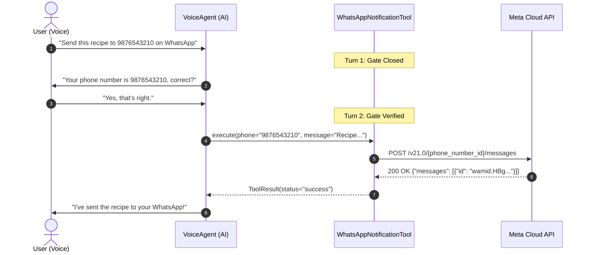

# WhatsApp Notifications & Messaging

`edgevoiceai` provides an integrated WhatsApp messaging pipeline designed specifically for voice agents. It features:
- **Multi-Provider Support**: Works with the official **Meta Cloud API** (Direct Text & Approved Templates) or **Custom Gateway / Webhook URLs**.
- **Phone Number Normalization**: Cleans and adds country calling codes automatically (e.g. `9876543210` $\rightarrow$ `919876543210`).
- **Strict 2-Turn Confirmation Protocol**: The model must verbally confirm the recipient's phone number and receive explicit confirmation before dispatching.
- **Zero-Boilerplate Agent Hook**: Passing `whatsapp=WhatsAppConfig(...)` into `VoiceConfig` automatically initializes and registers the tool with the agent.

---

## 1. Configuration Options

### Option A: Official Meta WhatsApp Business Cloud API
To send messages directly via Meta's Graph API:

```bash
# In your .env file or deployment environment:
export WHATSAPP_TOKEN="EAAG..."                 # Meta Permanent System User Access Token
export WHATSAPP_PHONE_NUMBER_ID="10492837482"   # Meta Registered Phone Number ID (Sender ID)
export WHATSAPP_DEFAULT_TEMPLATE=""             # Leave empty for direct text, or name an approved template
export WHATSAPP_DEFAULT_LANGUAGE="en"           # Template language code (e.g. "en", "gu", "hi")
export WHATSAPP_PHONE_PREFIX="91"               # Default country calling code (e.g. 91 for India, 1 for US)
```

### Option B: Custom Gateway, Internal Proxy, or Webhook Relay
If your organization uses a custom microservice, SMS gateway, or webhook relay:

```bash
export WHATSAPP_SERVICE_URL="https://api.yourcompany.com/v1/whatsapp/send"
export WHATSAPP_API_KEY="your-gateway-secret-token"
```

The client sends a clean JSON payload to your custom URL:
```json
{
  "phone": "919876543210",
  "message": "Here is your agricultural health report...",
  "template": "",
  "language": "en"
}
```

---

## 2. Python Setup & Automatic Registration

### Automatic Agent Registration (Recommended)
Pass `WhatsAppConfig` directly into `VoiceConfig`. `VoiceAgent` automatically creates and registers `WhatsAppNotificationTool` into its tool registry:

```python
import os
from edgevoiceai import VoiceAgent, VoiceConfig, WhatsAppConfig

# 1. Load config from environment
wa_config = WhatsAppConfig.from_env()

# 2. Attach to VoiceConfig
agent_config = VoiceConfig(
    api_key=os.environ["GEMINI_API_KEY"],
    whatsapp=wa_config,  # Auto-registers WhatsApp tool and rules
)

agent = VoiceAgent(config=agent_config)
```

### Explicit Tool Customization
You can also instantiate and customize the tool manually:

```python
from edgevoiceai import WhatsAppConfig, WhatsAppNotificationTool

wa_config = WhatsAppConfig(
    token=os.environ.get("WHATSAPP_TOKEN", ""),
    phone_number_id=os.environ.get("WHATSAPP_PHONE_NUMBER_ID", ""),
    phone_prefix="91",
    timeout=15.0,
)

wa_tool = WhatsAppNotificationTool(config=wa_config)
agent.register_tool(wa_tool)
```

---

## 3. The Strict 2-Turn Confirmation Protocol

Outbound messaging must never be triggered prematurely on the first turn. If a user says *"Send the formula to my WhatsApp on 9876543210"*, the assistant must not send it immediately.



### Runtime Verification Gate
If the model hallucinates and attempts to call `send_whatsapp_message` on the very first turn before obtaining verbal verification, `WhatsAppNotificationTool` intercepts the call and returns:

```json
{
  "status": "pending_confirmation",
  "message": "PHONE CONFIRMATION REQUIRED: First ask the user verbally: 'Your phone number is [phone_number], correct?' and stop speaking. Do not send until the user confirms."
}
```

This ensures zero accidental messages and zero dummy phone numbers.


