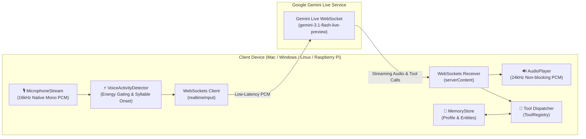

# Voice AI Framework

  <strong>A modular, full-duplex conversational voice framework for Python 3.10+</strong> 
  <em>Built for edge devices (Raspberry Pi, Linux) and laptops (macOS, Windows) powered by Google Gemini Live.</em>

---

## 🌟 Overview

The **Voice AI Framework** is a developer-first library designed to build low-latency, full-duplex conversational voice assistants from scratch. It bridges physical hardware microphones and speakers with Google Gemini's real-time bidirectional streaming API (`bidiGenerateContent`), enabling natural spoken conversations with instant turn-taking and barge-in interruptions.

Unlike traditional voice wrappers that rely on sequential Speech-To-Text (STT) $\rightarrow$ LLM $\rightarrow$ Text-To-Speech (TTS) pipelines, this framework operates over a continuous, bidirectional audio WebSocket connection.

---

## 🏗️ Architecture

---

## ✨ Key Capabilities

### ⚡ Ultra-Low Latency & Natural Barge-In
- **Continuous 16kHz Streaming**: Direct native hardware capture eliminates software resampling lag.
- **Natural Barge-In**: When you speak while the assistant is speaking, the speaker buffer is cleared instantly (<50ms), allowing natural interruptions.
- **Acoustic Echo Resistance**: Calibrated energy thresholds and streak detection prevent laptop speakers from interrupting themselves.

### 🧩 Self-Describing Tools with Prompt Templates
- **Per-Tool Prompt Templates**: Each tool declares its own usage rules, verbal etiquette, and confirmation protocols via `prompt_instruction`.
- **Dynamic Prompt Composition**: When tools are registered into `ToolRegistry`, their prompt instructions are automatically composed into the effective system prompt sent during the Gemini Live handshake.

### 🎙️ Multi-Platform Audio Device Routing
- **Independent Device Routing**: Automatically detects and routes microphones and speakers across separate USB sound cards, I2S DACs, or built-in laptop hardware.
- **Cross-Platform**: First-class support for macOS (CoreAudio), Windows (WASAPI/MME), Linux (ALSA/PulseAudio), and Raspberry Pi (snd-usb-audio).

### 🔍 Plug-and-Play RAG Vector Stores
- **Semantic Retrieval**: Built-in `RAGRetriever` orchestrates dense vector queries with fallback to keyword search.
- **Storage Backends**: Works out-of-the-box with `InMemoryVectorStore`, `QdrantVectorStore`, and `PineconeVectorStore`.

### 📱 Safe WhatsApp Notifications
- **Two-Turn Gate**: Prevents accidental messages by requiring explicit verbal phone number verification before dispatching.
- **Multi-Gateway**: Compatible with official **Meta Cloud API** and custom webhook endpoints.

---

## 🚀 Getting Started

Ready to build your first voice assistant in 5 minutes?

👉 **[Go to the 5-Minute Quickstart Guide](quickstart.md)**

